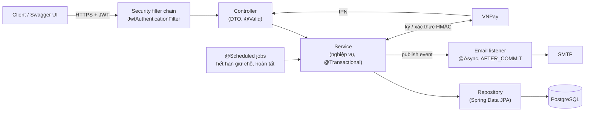
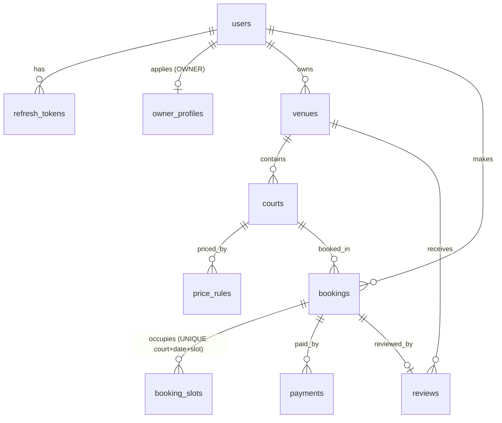

# Sport Booking API


REST API cho hệ thống đặt sân thể thao (bóng đá mini 5/7 người, cầu lông): khách tìm sân, xem giờ trống,
đặt và thanh toán qua VNPay; chủ sân quản lý sân, bảng giá, lịch đặt và doanh thu; admin duyệt chủ sân.

Dự án cá nhân phục vụ ứng tuyển vị trí **Intern Backend Java**. Trọng tâm không phải số lượng API mà là
**tính đúng khi nhiều người dùng cùng lúc** và các quyết định thiết kế có kiểm chứng bằng test.

## Điểm nổi bật

- **Không bao giờ đặt trùng giờ**: chống double booking bằng `UNIQUE` constraint của PostgreSQL. So sánh có số liệu
  với pessimistic / optimistic lock; test 50 request đồng thời → đúng 1 thành công. [Chi tiết](#-chống-đặt-trùng-double-booking)
- **Giữ chỗ 10 phút** chờ thanh toán; job `@Scheduled` tự hủy lượt quá hạn. Tranh chấp giữa job, khách hủy và
  thanh toán được giải quyết bằng `@Version` (optimistic lock) và thứ tự khóa cố định → không deadlock.
- **Thanh toán VNPay sandbox**: ký / xác thực HMAC-SHA512, IPN **idempotent** (VNPay gửi lại 10 lần, kể cả đồng thời,
  vẫn chỉ ghi nhận 1 lần), xử lý tiền về sau khi lượt đặt đã hết hạn. [Chi tiết](#-thanh-toán-vnpay)
- **Email bất đồng bộ đúng thời điểm**: `@Async` + `@TransactionalEventListener(AFTER_COMMIT)`: không gửi mail
  cho giao dịch bị rollback, không làm chậm response.
- **JWT access + refresh token** có rotation và phát hiện dùng lại token bị đánh cắp; khóa tài khoản có hiệu lực ngay.
- **~130 test** (unit, integration với PostgreSQL thật qua Testcontainers, API test qua HTTP), chạy tự động trên GitHub Actions.

## Tech stack

| Nhóm | Công nghệ |
|---|---|
| Ngôn ngữ, framework | Java 21, Spring Boot 3.5 (Web, Validation, Security, Data JPA, Mail, Actuator) |
| Dữ liệu | PostgreSQL 17, Hibernate, Flyway (4 migration) |
| Bảo mật | Spring Security, JWT (jjwt), BCrypt |
| Tích hợp | VNPay sandbox, SMTP (Mailpit khi dev) |
| Tài liệu API | springdoc-openapi (Swagger UI) |
| Kiểm thử | JUnit 5, Mockito, AssertJ, MockMvc, Testcontainers |
| Hạ tầng | Docker (multi-stage build), Docker Compose, GitHub Actions |

## Kiến trúc



Kiến trúc phân lớp `controller → service → repository`. Controller chỉ nhận/trả DTO (`record`), không bao giờ trả entity.
Entity không có setter, trạng thái chỉ đổi qua method nghiệp vụ (`booking.confirm()`, `booking.cancel(...)`).
Mapper viết tay. Code tích hợp bên ngoài nằm riêng trong `integration/` (adapter): thêm MoMo không phải sửa service.

```
com.sportbooking
├── config/        Security, OpenAPI, Async, Scheduling, *Properties, dữ liệu mẫu
├── security/      JWT filter, JwtService, xử lý 401/403
├── controller/    REST endpoint
├── service/       nghiệp vụ + logic thuần tách riêng để unit test (CancellationPolicy, BookingSlotCalculator...)
├── scheduler/     BookingExpirationJob, BookingCompletionJob
├── event/         sự kiện nghiệp vụ (BookingConfirmedEvent...)
├── integration/   vnpay/ (ký, IPN), email/ (soạn và gửi mail)
├── repository/    Spring Data JPA, Specification, projection
├── entity/, dto/, mapper/, validation/, exception/, common/
```

## Chạy project

Yêu cầu: Docker. Muốn chạy từ IDE thì cần thêm JDK 21 (và Maven, IntelliJ đã có sẵn).

### Cách 1: chạy toàn bộ bằng Docker (không cần cài Java)

```bash
docker compose --profile app up -d --build
```

Lần đầu mất vài phút để tải thư viện. Khi `docker compose ps` báo `sportbooking-app` là `healthy`:

| | |
|---|---|
| Swagger UI | http://localhost:8080/swagger-ui.html |
| Mailpit (xem email app gửi) | http://localhost:8025 |
| Health check | http://localhost:8080/actuator/health |

Dừng: `docker compose --profile app down` (thêm `-v` để xóa sạch database).

### Cách 2: chạy app từ IDE (khi phát triển)

```bash
docker compose up -d      # chỉ PostgreSQL + Mailpit
mvn spring-boot:run       # hoặc Run SportBookingApplication trong IntelliJ
```

### Chạy test

```bash
mvn test     # cần Docker đang chạy: Testcontainers tự khởi động 1 PostgreSQL 17 riêng cho test
```

### Tài khoản demo (profile `dev`, mặc định)

Lần chạy đầu tự tạo 4 cụm sân ở Hà Nội (1 cụm đang tạm ngừng để thử bộ lọc). Mật khẩu: `Demo@123456`.

| Email | Role |
|---|---|
| `customer@sportbooking.vn` | CUSTOMER |
| `owner@sportbooking.vn` | OWNER, sở hữu các sân mẫu |
| `admin@sportbooking.vn` (mật khẩu `Admin@123456`) | ADMIN |

Trên Swagger: gọi `POST /api/v1/auth/login`, sao chép `accessToken`, bấm **Authorize** và dán vào.

### Biến môi trường

Secret đặt trong file `.env` (xem `.env.example`; file này nằm trong `.gitignore`, **không commit**).
Cả `mvn spring-boot:run` lẫn Docker Compose đều tự đọc file này.

| Biến | Mặc định (chỉ để dev) | Ý nghĩa |
|---|---|---|
| `SPRING_PROFILES_ACTIVE` | `dev` | `dev` tạo dữ liệu mẫu. `prod` bắt buộc có `JWT_SECRET`, `ADMIN_EMAIL`, `ADMIN_PASSWORD`, thiếu là app không khởi động (fail fast) |
| `DB_URL`, `DB_USERNAME`, `DB_PASSWORD` | `jdbc:postgresql://localhost:5432/sport_booking`, `sport` / `sport123` | Kết nối PostgreSQL |
| `JWT_SECRET` | khóa dev trong `application.yml` | Base64 của khóa ≥ 256 bit. Tạo: `openssl rand -base64 32` |
| `ADMIN_EMAIL`, `ADMIN_PASSWORD` | `admin@sportbooking.vn` / `Admin@123456` | Tài khoản ADMIN tạo khi khởi động lần đầu |
| `VNPAY_TMN_CODE`, `VNPAY_HASH_SECRET` | (trống: API thanh toán báo "chưa cấu hình") | Thông tin sandbox VNPay |
| `VNPAY_RETURN_URL` | `http://localhost:8080/api/v1/payments/vnpay/return` | Nơi VNPay đưa trình duyệt về |
| `MAIL_HOST`, `MAIL_PORT`, `MAIL_USERNAME`, `MAIL_PASSWORD` | `localhost`, `1025` (Mailpit) | Máy chủ SMTP |

## Chức năng và API

Prefix `/api/v1`. Tài liệu đầy đủ (tham số, ví dụ, mã lỗi) ở Swagger UI.

| Vai trò | Chức năng | Endpoint chính |
|---|---|---|
| Ai cũng dùng được | Đăng ký, đăng nhập, làm mới token | `POST /auth/register`, `/auth/login`, `/auth/refresh`, `/auth/logout` |
| | Tìm sân: tên, khu vực, loại sân, khoảng giá, **còn trống lúc X giờ**; phân trang, sắp xếp | `GET /venues` |
| | Chi tiết cụm sân + bảng giá; lịch trống theo slot 30 phút; đánh giá | `GET /venues/{id}`, `/courts/{id}/availability`, `/venues/{id}/reviews` |
| CUSTOMER | Đặt sân, xem lịch sử, hủy theo chính sách | `POST /bookings`, `GET /bookings/me`, `POST /bookings/{id}/cancel` |
| | Thanh toán VNPay | `POST /bookings/{id}/payments` |
| | Đánh giá lượt đã chơi | `POST /bookings/{id}/review` |
| | Xin làm chủ sân | `POST /owner-applications` |
| OWNER | Cụm sân, sân con, bảng giá theo khung giờ / ngày thường / cuối tuần | `/owner/venues/**`, `/owner/courts/**` |
| | Lịch đặt theo ngày, hủy lượt đặt (khách nhận email) | `GET /owner/venues/{id}/bookings`, `POST /owner/bookings/{id}/cancel` |
| | Thống kê doanh thu theo ngày / theo sân | `GET /owner/statistics/revenue` |
| ADMIN | Quản lý, khóa người dùng; duyệt chủ sân | `/admin/users/**`, `/admin/owner-applications/**` |
| VNPay (server gọi server) | IPN và return URL, xác thực bằng chữ ký | `GET /payments/vnpay/ipn`, `/payments/vnpay/return` |

Mọi response có cùng một dạng:

```json
{ "success": true,  "data": { ... }, "timestamp": "2026-11-06T10:15:30Z" }
{ "success": false, "error": { "code": "SLOT_ALREADY_BOOKED", "message": "Khung giờ này đã có người đặt..." }, "timestamp": "..." }
```

`error.code` cố định để client xử lý; lỗi validation có thêm `error.details` liệt kê từng field sai.
Không bao giờ trả stack trace ra ngoài.

## ⭐ Chống đặt trùng (double booking)

**Vấn đề.** "Kiểm tra còn trống rồi mới lưu" (check-then-act) là SAI khi có nhiều request cùng lúc:
cả hai cùng đọc thấy "trống" trước khi ai kịp lưu → cả hai cùng đặt thành công.

```
Thời gian   Request A                     Request B
   t1       SELECT: 17:00 còn trống
   t2                                     SELECT: 17:00 còn trống
   t3       INSERT booking 17:00
   t4                                     INSERT booking 17:00   ← trùng!
```

**Giải pháp đã chọn: UNIQUE constraint.** Mỗi lượt đặt được tách thành các slot 30 phút lưu vào
`booking_slots` với `UNIQUE (court_id, slot_date, slot_start)`, trong cùng transaction với booking.
Request đến sau INSERT trùng slot sẽ bị PostgreSQL chặn (`duplicate key`) → rollback → trả `409 SLOT_ALREADY_BOOKED`.

| Cách | Cơ chế | Ưu | Nhược |
|---|---|---|---|
| **Unique constraint** ✅ | DB từ chối dòng trùng | Database đảm bảo, đúng cả khi chạy nhiều instance; các slot khác nhau chạy song song; ít code | Cần mô hình slot rời rạc; phát hiện qua exception |
| Pessimistic lock | `SELECT ... FOR UPDATE` dòng của sân, rồi kiểm tra và ghi | Dùng được cho khoảng giờ tự do | Xếp hàng **mọi** request của sân, kể cả không tranh nhau; giữ khóa lâu; nguy cơ deadlock; phải nhớ khóa ở mọi chỗ ghi |
| Optimistic lock | Cột `version`, `UPDATE ... WHERE version = ?` | Không khóa khi đọc | Request thua đã làm hết việc rồi mới bị hủy; nhiều tranh chấp → phải retry nhiều; không tự nhiên với INSERT |

Kết quả thí nghiệm trên PostgreSQL thật (`LockingStrategiesIntegrationTest`, 50ms xử lý giữa kiểm tra và ghi):

| | 50 request cùng đặt 17:00 | 20 request đặt 20 slot khác nhau |
|---|---|---|
| check-then-act | **nhiều dòng trùng** ❌ | |
| Unique constraint | 1 dòng ✅ | ~0,35 giây |
| Pessimistic lock | 1 dòng ✅ | ~1,2 giây (xếp hàng từng request) |
| Optimistic lock | 1 dòng ✅ | |

Kiểm chứng trên code thật (`BookingConcurrencyIntegrationTest`): 50 thread gọi `BookingService` cùng lúc
→ đúng 1 thành công, 49 nhận `SLOT_ALREADY_BOOKED`, database có đúng 1 booking và 2 slot.
Hai khoảng giao nhau (17:00–18:00 và 17:30–18:30) cũng chỉ 1 thắng; hai khoảng liền kề (17–18h, 18–19h) đều thành công.
Slot luôn được INSERT theo thứ tự giờ tăng dần nên không xảy ra deadlock.

**Ba loại tranh chấp, ba công cụ, mỗi cái đúng chỗ:**

| Tình huống | Công cụ | Vì sao |
|---|---|---|
| Nhiều người cùng **thêm** lượt đặt vào cùng slot | `UNIQUE` constraint | Không có dòng nào để khóa trước khi INSERT |
| Nhiều bên cùng **sửa** 1 lượt đặt (job hết hạn, khách hủy, IPN) | `@Version` (optimistic) | Hiếm khi xảy ra; bên thua bỏ qua hoặc trả 409 |
| VNPay gửi **trùng** IPN cho 1 giao dịch | `SELECT ... FOR UPDATE` (pessimistic) trên 1 dòng payment | Trùng lặp là có chủ đích; khóa 1 dòng, rất ngắn |
| Nhiều người cùng **đánh giá** 1 cụm sân | `UPDATE ... SET count = count + 1` (nguyên tử) | Database tự xếp hàng, không cần đọc lên Java |

## Vòng đời lượt đặt

```
PENDING ──(thanh toán)──> CONFIRMED ──(chơi xong)──> COMPLETED ──> được đánh giá
   │                          │
   ├──(quá 10 phút)──> EXPIRED │
   └──(khách / chủ sân hủy)────┴──> CANCELLED
```

- **Đặt sân:** giờ tròn `:00`/`:30`, trong giờ mở cửa, đặt trước tối đa 30 ngày; bóng đá tối thiểu 1 tiếng,
  cầu lông 30 phút, tối đa 4 tiếng; tối đa 3 lượt chưa thanh toán cùng lúc. Giá do **server** tính theo từng slot
  (lượt đặt vắt qua 2 khung giá vẫn đúng), không nhận giá từ client.
- **Tự hết hạn:** `BookingExpirationJob` (`@Scheduled`, `fixedDelay` 30 giây) chuyển PENDING quá hạn sang EXPIRED và nhả slot.
  Mỗi booking xử lý trong 1 transaction riêng; query dùng partial index `idx_bookings_pending_expiry`.
- **Hủy:** khách hủy PENDING lúc nào cũng được (trước giờ chơi); lượt đã thanh toán chỉ hủy được trước giờ chơi ≥ 24 giờ.
  Chủ sân hủy được lượt tại sân của mình, bắt buộc ghi lý do, khách nhận email. Slot được nhả ngay.
- **Cuộc đua job ↔ khách hủy ↔ thanh toán:** `@Version` đảm bảo chỉ một bên thắng. Mọi luồng đều UPDATE `bookings`
  trước rồi mới xóa `booking_slots` → cùng thứ tự khóa → không deadlock. Test cho job và lệnh hủy chạy song song 10 lần:
  lần nào cũng đúng 1 bên thắng.
- **Tự hoàn tất:** `BookingCompletionJob` (5 phút) chuyển CONFIRMED đã qua giờ kết thúc sang COMPLETED bằng 1 câu
  UPDATE hàng loạt. Bulk update bỏ qua `@Version`, nên câu lệnh tự tăng `version` và `updated_at`.

## ⭐ Thanh toán VNPay

```
Khách ──POST /bookings/{id}/payments──> Server: lưu Payment PENDING, trả paymentUrl đã ký
Khách ──mở paymentUrl──> trang VNPay ──thanh toán──┬──> IPN (server VNPay gọi server mình)   ← GHI NHẬN TIỀN
                                                    └──> Return URL (trình duyệt quay về)    ← CHỈ HIỂN THỊ
```

| Nguyên tắc | Cách làm |
|---|---|
| Không tin dữ liệu chưa ký | Mọi tham số từ VNPay được kiểm tra chữ ký HMAC-SHA512 trước khi đọc DB; so sánh chữ ký bằng `MessageDigest.isEqual` (constant-time) |
| IPN là nguồn sự thật duy nhất | Return URL đi qua trình duyệt, khách có thể đóng tab: chỉ hiển thị, không đổi trạng thái |
| Idempotent | IPN gửi lại (kể cả đồng thời) chỉ xử lý 1 lần: khóa dòng payment `FOR UPDATE`, đã xử lý thì trả `02` |
| Đối chiếu số tiền | `vnp_Amount / 100` phải bằng số tiền đã lưu, lệch thì trả `04` |
| Hạn thanh toán = hạn giữ chỗ | `vnp_ExpireDate` = `expires_at` của lượt đặt |
| Tiền về khi lượt đặt đã hết hạn | Không "hồi sinh" lượt đặt (slot có thể đã thuộc người khác): payment `REFUND_REQUIRED` |
| Tranh chấp với job hết hạn | `@Version` trên booking; IPN thua trả `99` → VNPay tự gửi lại → lần sau xử lý theo trạng thái mới |

Mã trả về cho VNPay: `00` xử lý xong · `01` không thấy giao dịch · `02` đã xử lý · `04` sai số tiền · `97` sai chữ ký · `99` lỗi khác.

<details>
<summary><b>Chạy thử với sandbox VNPay</b></summary>

1. Đăng ký tại https://sandbox.vnpayment.vn/devreg/ để nhận `vnp_TmnCode` và `vnp_HashSecret` qua email.
2. `cp .env.example .env`, điền 2 giá trị trên, khởi động lại app.
3. Đăng nhập customer, đặt sân, gọi `POST /api/v1/bookings/{id}/payments`, mở `paymentUrl` trên trình duyệt,
   thanh toán bằng thẻ test của sandbox (ngân hàng NCB).
4. **IPN khi chạy trên máy cá nhân:** VNPay không gọi được `localhost`. Hai cách:
   - Mở tunnel HTTPS (`ngrok http 8080` hoặc `cloudflared tunnel --url http://localhost:8080`) và cấu hình IPN URL
     `https://<tunnel>/api/v1/payments/vnpay/ipn` trong trang quản trị merchant sandbox.
   - Cách nhanh khi học: trình duyệt quay về return URL kèm đầy đủ tham số `vnp_*` đã được VNPay ký, đúng bộ tham số
     của IPN. Sao chép phần query đó và gọi `GET /api/v1/payments/vnpay/ipn?<query>` để mô phỏng IPN.

</details>

## Email bất đồng bộ

```
Transaction (IPN / chủ sân hủy) ──publishEvent──> [chờ COMMIT] ──> thread "mail-*" ──> SMTP
                                   rollback? ──> không gửi gì
```

- **`@TransactionalEventListener(AFTER_COMMIT)`**: chỉ gửi khi dữ liệu đã thật sự lưu. Gửi ngay trong transaction thì
  có thể "báo đặt thành công" rồi transaction lại rollback, và transaction bị giữ lâu chờ SMTP.
- **`@Async("mailExecutor")`**: thread pool riêng (2–4 thread, hàng đợi 500) để SMTP chậm không làm chậm phản hồi IPN.
  Lỗi gửi mail chỉ ghi log, không ảnh hưởng nghiệp vụ.
- **Event mang snapshot** (`BookingEmailData`): dữ liệu được đọc xong trong transaction; thread gửi mail không đụng tới
  entity / quan hệ LAZY.

## Đánh giá và thống kê

- **Đánh giá:** chỉ lượt COMPLETED của chính mình, mỗi lượt 1 lần (`UNIQUE(booking_id)`), 1–5 sao. Điểm trung bình
  cập nhật bằng 1 câu UPDATE nguyên tử nên không mất lượt khi nhiều người đánh giá cùng lúc:

  | Cách cập nhật (20 đánh giá đồng thời, đo trên PostgreSQL) | `review_count` |
  |---|---|
  | Đọc lên Java, cộng, ghi lại | 1, mất 19 lượt |
  | Tính lại bằng subquery trong UPDATE | 19, vẫn có thể mất |
  | `review_count = review_count + 1` (đang dùng) | **20**, đúng |

- **Thống kê doanh thu:** chỉ tính CONFIRMED + COMPLETED, nhóm theo ngày hoặc theo sân con bằng `GROUP BY` trong database
  (không tải hết booking lên Java). Ngày không có lượt nào vẫn hiện với doanh thu 0. Khoảng tối đa 366 ngày.

## Xác thực và phân quyền

- **Access token**: JWT ký HMAC-SHA256, sống 15 phút, gửi kèm header `Authorization: Bearer <token>`.
- **Refresh token**: chuỗi ngẫu nhiên 256 bit, sống 7 ngày, DB chỉ lưu hash SHA-256. Mỗi refresh token chỉ dùng được
  1 lần (rotation). Dùng lại token đã thu hồi → thu hồi toàn bộ phiên của user (phát hiện token bị đánh cắp).
- Server luôn đọc role và trạng thái mới nhất từ DB ở mỗi request, không tin role ghi trong token:
  khóa tài khoản hay được duyệt làm chủ sân đều có hiệu lực ngay.
- Phân quyền theo URL (`/owner/**` cần OWNER, `/admin/**` cần ADMIN). Dữ liệu của người khác trả **404** thay vì 403
  để không lộ sự tồn tại (chống IDOR).

| Mã lỗi | HTTP | Client nên làm gì |
|---|---|---|
| `UNAUTHORIZED` | 401 | Chưa gửi token → đăng nhập |
| `TOKEN_EXPIRED` | 401 | Gọi `/auth/refresh` rồi thử lại request |
| `INVALID_TOKEN` | 401 | Token hỏng / bị sửa → đăng nhập lại |
| `INVALID_REFRESH_TOKEN` | 401 | Đăng nhập lại |
| `ACCOUNT_LOCKED` | 403 | Tài khoản bị khóa |
| `FORBIDDEN` | 403 | Không đủ quyền |

## Kiểm thử

| Loại | Chạy ở đâu | Ví dụ |
|---|---|---|
| Unit test | JVM thuần, mock bằng Mockito, không Spring | `CancellationPolicyTest`, `BookingSlotCalculatorTest`, `VnPaySignerTest` (test vector HMAC), `AuthServiceTest` |
| Integration test | Spring + **PostgreSQL thật** (Testcontainers) | `BookingConcurrencyIntegrationTest` (50 thread), `PaymentFlowIntegrationTest` (10 IPN đồng thời), `ReviewIntegrationTest` (lost update) |
| API test | HTTP qua MockMvc: security → controller → DB → JSON | `FullJourneyApiTest` (đăng ký → duyệt chủ sân → tạo sân → đặt → thanh toán → đánh giá → doanh thu), `SecurityApiTest`, `ErrorResponseApiTest` |

Vì sao dùng PostgreSQL thật thay vì H2: unique constraint, `FOR UPDATE`, partial index, JSONB và hành vi đồng thời
là đặc thù của PostgreSQL; test trên H2 xanh không chứng minh được gì về production.

## Database



Schema do **Flyway** quản lý (`src/main/resources/db/migration`, V1–V4), Hibernate chỉ `validate`.
Mọi constraint đều có tên để ánh xạ lỗi database sang mã lỗi nghiệp vụ.

## Quyết định thiết kế chính

- **Slot cố định 30 phút** trong bảng `booking_slots` là nền tảng của việc chống đặt trùng bằng UNIQUE.
- **Tiền lưu bằng `BIGINT` (VND)**, không dùng `double`. Giá theo giờ là bội số 1.000đ nên giá 1 slot luôn nguyên.
- **Múi giờ:** nghiệp vụ dùng `Asia/Ho_Chi_Minh` dù server chạy ở đâu; mốc thời gian lưu `TIMESTAMPTZ`.
  **Inject `Clock`** thay vì gọi `Instant.now()` để test được logic phụ thuộc thời gian.
- **Phân trang an toàn:** `size ≤ 100`, chỉ cho sắp xếp theo whitelist, luôn thêm `id` làm tiêu chí phụ để thứ tự ổn định.
- **Chống N+1:** `@EntityGraph`, `JOIN FETCH`, truy vấn `IN` theo lô; trang tìm sân luôn 3 câu SQL bất kể số kết quả.
- **Partial index** cho các truy vấn của job (`WHERE status = 'PENDING'`), với hằng số trong JPQL để PostgreSQL dùng được index.
- **Fail fast ở production:** profile `prod` không có giá trị mặc định cho secret.
- **Docker image:** multi-stage (image chạy chỉ có JRE), chạy bằng user thường, tách thư viện và code thành 2 layer
  để mỗi lần sửa code chỉ build lại vài trăm KB; `HEALTHCHECK` qua `/actuator/health/readiness`.

## Giới hạn đã biết và hướng phát triển

Giới hạn hiện tại (có chủ đích giữ MVP đơn giản):

- Sân không mở qua nửa đêm (giờ đóng cửa muộn nhất 23:30). Tỉnh/quận so khớp có dấu ("Ha Dong" ≠ "Hà Đông").
- Giới hạn 3 lượt chưa thanh toán là giới hạn "mềm" (request song song của cùng 1 khách có thể vượt nhẹ).
  Lượt PENDING quá hạn có thể chiếm slot thêm tối đa ~30 giây tới lần chạy kế tiếp của job.
- Chạy nhiều instance: job vẫn đúng nhờ `@Version` nhưng các instance có thể làm trùng việc.
- Hoàn tiền xử lý thủ công; chưa có job đối soát VNPay (querydr) cho giao dịch không nhận được IPN.
- Email có thể mất nếu app tắt đúng lúc giữa commit và gửi (hàng đợi trong RAM).
- Đăng xuất chỉ thu hồi refresh token; access token còn dùng được tối đa 15 phút.
- Lượt khách không tới chơi (no-show) vẫn thành COMPLETED.

Hướng phát triển: Redis (cache tìm sân, rate limit đăng nhập, blacklist access token, khóa phân tán cho job / ShedLock),
Outbox pattern cho email, VNPay refund API, tìm kiếm không dấu (`unaccent`, `pg_trgm`), đặt sân định kỳ, mã giảm giá.

<details>
<summary><b>Ví dụ gọi API bằng curl</b></summary>

```bash
# Đăng nhập (tài khoản demo)
curl -X POST http://localhost:8080/api/v1/auth/login -H "Content-Type: application/json" \
  -d '{"email":"customer@sportbooking.vn","password":"Demo@123456"}'

# Tìm sân bóng 5 người ở Hà Nội còn trống 17:00–18:30, sắp theo điểm đánh giá
curl "http://localhost:8080/api/v1/venues?city=Hà%20Nội&sportType=FOOTBALL_5&date=2026-11-09&startTime=17:00&endTime=18:30&sort=avgRating,desc"

# Lịch trống 1 ngày của sân, theo slot 30 phút
curl "http://localhost:8080/api/v1/courts/1/availability?date=2026-11-09"

# Đặt sân -> 201, PENDING, giữ chỗ 10 phút
curl -X POST http://localhost:8080/api/v1/bookings -H "Authorization: Bearer <accessToken>" \
  -H "Content-Type: application/json" \
  -d '{"courtId":1,"date":"2026-11-09","startTime":"17:00","endTime":"18:30"}'

# Tạo link thanh toán VNPay
curl -X POST http://localhost:8080/api/v1/bookings/5/payments -H "Authorization: Bearer <accessToken>"

# Hủy lượt đặt
curl -X POST http://localhost:8080/api/v1/bookings/5/cancel -H "Authorization: Bearer <accessToken>" \
  -H "Content-Type: application/json" -d '{"reason":"Bận việc đột xuất"}'

# Đánh giá lượt đã chơi xong
curl -X POST http://localhost:8080/api/v1/bookings/5/review -H "Authorization: Bearer <accessToken>" \
  -H "Content-Type: application/json" -d '{"rating":5,"comment":"Sân đẹp"}'

# Chủ sân: lịch đặt 1 ngày, doanh thu theo ngày
curl "http://localhost:8080/api/v1/owner/venues/1/bookings?date=2026-11-09" -H "Authorization: Bearer <ownerToken>"
curl "http://localhost:8080/api/v1/owner/statistics/revenue?venueId=1&from=2026-11-01&to=2026-11-30&groupBy=DAY" \
  -H "Authorization: Bearer <ownerToken>"
```

</details>
